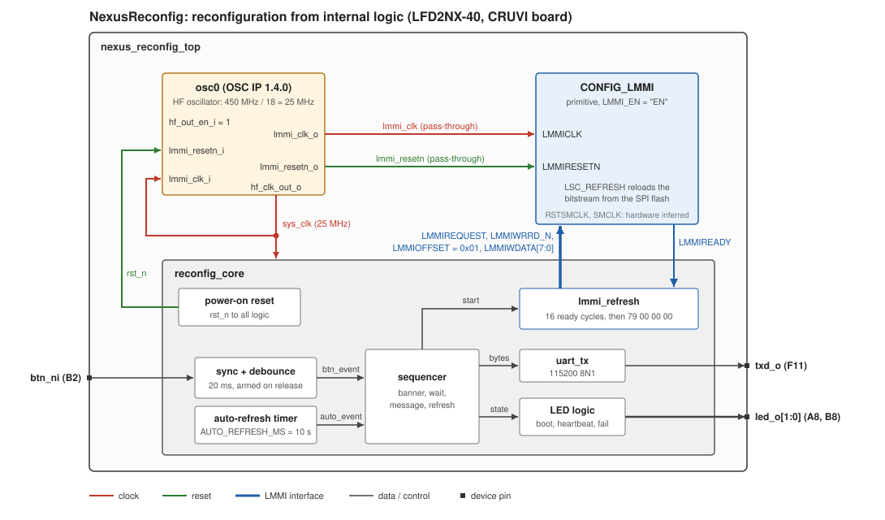

# NexusReconfig - Certus-NX reconfiguration from internal logic

| Info: | Details |
| :-- | :-- |
| Device | Certus-NX LFD2NX-40-8BG196C |
| Board | CRUVI Certus-NX board |
| Software | Radiant 2026.1.1 (Synplify Pro), Questa (bundled with Radiant) |
| HDL | Two equivalent implementations: SystemVerilog (`src/sv/`) and VHDL-2008 (`src/vhdl/`); testbenches in both languages; OSC IP Verilog |
| IP | osc 1.4.0 (`lscc/osc0`) |

## Notes

- This reference design shows how user logic inside a Certus-NX FPGA can force the device to
  reconfigure itself, with no external pin (PROGRAMN), JTAG cable or host involved.
- The design writes the `LSC_REFRESH` command (opcode `0x79`) to the device's configuration block
  through the `CONFIG_LMMI` primitive. `LSC_REFRESH` is equivalent to toggling PROGRAMN: the
  configuration SRAM is cleared and the bitstream is reloaded from the boot source, which on
  Certus-NX is the external SPI flash.
- The reconfiguration therefore loads **whatever image is in the SPI flash**. To see this design
  restart itself, its bitstream must be in the flash (see "Running on the board").

- The design exists in two languages, kept side by side on one branch: SystemVerilog in
  `src/sv/` and VHDL-2008 in `src/vhdl/`. One Radiant project builds either of them: the
  implementation `impl_sv` (project default) or `impl_vhdl`. Both share the device settings,
  strategy, oscillator IP and constraints. The two implementations are checked against each
  other cycle by cycle in simulation (see "VHDL-2008 implementation"), and both were tested on
  the board.

## Releases (git tags)

| Tag | Tool version | IP versions | Content | Verification |
| :-- | :-- | :-- | :-- | :-- |
| `r2026.1.1` | Radiant 2026.1.1 | osc 1.4.0 | First release: SystemVerilog (`impl_sv`) and VHDL-2008 (`impl_vhdl`) implementations in one project, testbenches in both languages | Both implementations: timing met, RTL simulation PASS, lock-step equivalence 0 mismatches, hardware test passed on the CRUVI board |

## How it works

1. After configuration a power-on counter releases the logic. The UART prints
   `NexusReconfig: FPGA configured`, `led_o[0]` lights for 2 s (a fresh-configuration indicator)
   and `led_o[1]` blinks at 2 Hz.
2. A reconfiguration request comes from either:
   - a press on the active-low input `btn_ni` (pin B2), debounced for 20 ms. The input must be
     seen released before a press counts, so a stuck-low input cannot cause a refresh loop; or
   - the auto-refresh timer, 10 s after the banner (`AUTO_REFRESH_MS`, 0 disables it).
3. The UART prints `NexusReconfig: issuing LSC_REFRESH`. When the last character has left the
   UART, `lmmi_refresh` waits for 16 consecutive cycles with `LMMIREADY` high, then writes the
   four bytes `79 00 00 00` (opcode and three operands) to LMMI offset `0x01`.
4. The device reconfigures and the sequence starts again at step 1.
5. If the device is still running after the command, the refresh was not executed and
   `led_o[0]` flashes quickly (64 ms) as a failure indicator.

### LMMI protocol

From the sysCONFIG User Guide for Nexus Platform, FPGA-TN-02099-3.7, Appendix D:

- The configuration register has the fixed LMMI offset `ADDR_CFG = 0x01` (D.3).
- A command is an opcode byte and three operand bytes, written back to back with
  `LMMIREQUEST` and `LMMIWRRD_N` high; a byte is taken on each clock edge where `LMMIREADY` is
  high (Figures D.4 to D.6).
- `LSC_REFRESH` is the only Class D command and is executed as a Class C command (no data, no
  read-back). Once it executes, the LMMI host in the fabric no longer exists (D.3).
- `OPERAND1 = 0x00` leaves the Override ENABLE bit (bit 6) clear, so the refresh uses the
  device's normal boot settings (Table 6.20).
- Wait at least four LMMI clock cycles after `LMMIREADY` is high before issuing a command (D.3).
- `LMMICLK` is at most 50 MHz (Table D.1). `LMMICLK` and `LMMIRESETN` must come from the OSC IP's
  `lmmi_clk_o` / `lmmi_resetn_o` pass-through outputs, or the software stops with an error (D.2).
  The OSC IP is generated with `LMMI_CLK_EN = ENABLED`.
- `RSTSMCLK` and `SMCLK` are hardware inferred and left unconnected, as in FPGA-RD-02294.

The command sequence is the `LSC_REFRESH` step of the refresh controller in the Lattice Nexus
Multi-Boot reference design FPGA-RD-02294 (`source/impl_1/refresh.v`), without its Multi-Boot steps
(`ISC_ENABLE_X`, `LSC_PROG_CNTRL0`, `ISC_DISABLE` and the `MULTIBOOT` primitive), which are only
needed to select an alternate image.

## Contents

| Path | Content |
| :-- | :-- |
| `src/sv/nexus_reconfig_top.sv`, `src/vhdl/nexus_reconfig_top.vhd` | Top level: OSC IP, `CONFIG_LMMI` primitive, `reconfig_core` |
| `src/sv/reconfig_core.sv`, `src/vhdl/reconfig_core.vhd` | Power-on reset, button debounce, auto timer, UART messages, LEDs, sequencer |
| `src/sv/lmmi_refresh.sv`, `src/vhdl/lmmi_refresh.vhd` | LMMI host that writes `LSC_REFRESH` |
| `src/sv/uart_tx.sv`, `src/vhdl/uart_tx.vhd` | UART transmitter, 8N1 |
| `src/vhdl/nexus_reconfig_pkg.vhd` | VHDL only: `clog2` and string-to-ROM helper functions |
| `lscc/osc0/` | Generated OSC IP (25 MHz HF clock, LMMI clock path enabled), used by both implementations |
| `lscc/nexus_reconfig.rdf` | Radiant project with the implementations `impl_sv` (default) and `impl_vhdl` |
| `lscc/nexus_reconfig_*_{sv,vhdl}_ftusb0.xcf` | Programmer chain files per implementation (see "Running on the board") |
| `constraints/nexus_reconfig.pdc` | Clock, pins, INITN release, false paths (post-synthesis) |
| `constraints/nexus_reconfig.sdc` | Clock for synthesis |
| `tb/tb_reconfig_core.sv` | Self-checking SystemVerilog testbench with an LMMI target model and UART monitors (ports only: runs against either implementation) |
| `tb/tb_reconfig_core.vhd` | The same testbench in VHDL-2008 (ports only, component binding: runs against either implementation) |
| `tb/tb_equiv.sv` | Lock-step equivalence testbench: VHDL-2008 against SystemVerilog |
| `sim/sim_sv_filelist.f` | SystemVerilog design, SystemVerilog testbench |
| `sim/sim_vhdl_filelist.f` | VHDL design, VHDL testbench |
| `sim/sim_sv_vhdtb_filelist.f` | SystemVerilog design, VHDL testbench |
| `sim/sim_vhdl_svtb_filelist.f` | VHDL design, SystemVerilog testbench |
| `sim/equiv_filelist.f` | `tb_equiv` with both implementations |
| `sim/lint_top_sv_filelist.f`, `sim/lint_top_vhdl_filelist.f` | Elaborate-only check of the full top level, per implementation |
| `sim/run_vhdl.do` | Questa run script for the simulations with VHDL design units |
| `scripts/create_project.tcl` | Re-creates the Radiant project with both implementations (VHDL-2008 enabled for Synplify Pro and LSE) |
| `scripts/build_all.tcl` | Builds both implementations |
| `scripts/make_sv_ref.sh` | Copies `src/sv/` with `ref_` module names into `sim/mcp_sim/sv_ref/` for `tb_equiv` |
| `scripts/make_tb_check.sh` | Prepares the fault-injection check of both testbenches in `sim/mcp_sim/tb_check/` |
| `logs/` | Programmer logs and raw UART captures of the hardware tests |
| `docs/` | FPGA-TN-02099 (sysCONFIG) and FPGA-TN-02145 (Multi-Boot) user guides, block diagram (`block_diagram.svg`) |

### Ports and pins

| Port | Pin | Direction | Function |
| :-- | :-- | :-- | :-- |
| `btn_ni` | B2 | in, pull-up | Reconfiguration request, active low |
| `led_o[0]` | A8 | out | On for 2 s after configuration; fast flash if the refresh did not execute |
| `led_o[1]` | B8 | out | 2 Hz heartbeat |
| `txd_o` | F11 | out | UART, 115200 baud, 8N1 |

Pins come from the CRUVI board design
(`/mnt/lscc/devel/Boards/CertusNX/cruvi/CruviDemo/test_certus/test_certus.pdc`). B2 is the INITN
sysCONFIG pin; like the CRUVI design, the `.pdc` releases it with
`ldc_set_sysconfig {INITN_PORT=DISABLE}`.

### Parameters (`nexus_reconfig_top`)

| Parameter | Default | Meaning |
| :-- | :-- | :-- |
| `AUTO_REFRESH_MS` | 10000 | Auto-refresh delay after the banner; 0 = button only |
| `LED_ACTIVE_LOW` | `false` / `1'b0` | Set if the board LEDs light on a low level (VHDL `boolean`, SystemVerilog `bit`) |

## Reproducing the results

All Lattice tools run on the build host `lb` with Radiant 2026.1.1, through the `lattice-prompt`
MCP server.

1. **Oscillator IP** (already in `lscc/osc0`; only needed to regenerate it):
   `radiant_ip_generate(name=osc0, ip_module_dir=/mnt/tools/lscc/radiant/2026.1.1/ip/lifcl/osc,
   device=LFD2NX-40, family=LFD2NX, package=CABGA196, performance=8_High-Performance_1.0V,
   operation=Commercial, output_dir=<project>/lscc/osc0,
   cfg_values="HF_OSC_EN:ENABLED; HF_CLK_FREQ:25; LF_OUTPUT_EN:DISABLED; SEDCLK_EN:0; LMMI_CLK_EN:ENABLED")`.
2. **Project** (already in `lscc/nexus_reconfig.rdf`; only needed to re-create it):
   `radiant_build_detached(tcl_path=<project>/scripts/create_project.tcl)`. The tool reports
   `failed` because no build stage runs; check that `lscc/nexus_reconfig.rdf` lists `impl_sv`
   and `impl_vhdl`.
3. **Build both implementations:** `radiant_build_detached(tcl_path=<project>/scripts/build_all.tcl)`,
   `radiant_build_wait(project_dir=<project>/scripts)`, then
   `validate_timing(project_path=<project>/lscc/impl_sv)` and
   `validate_timing(project_path=<project>/lscc/impl_vhdl)`. The bitstreams are
   `lscc/impl_sv/nexus_reconfig_impl_sv.bit` and `lscc/impl_vhdl/nexus_reconfig_impl_vhdl.bit`.
   Do not use `radiant_build_detached(rdf_path=..., impl=impl_vhdl)`: the MCP tool (2026-11-14)
   ignores `impl` and always builds the project's default implementation (`impl_sv`). The
   `prj_run_*` commands have no `-impl` option, so `build_all.tcl` activates each
   implementation in turn with `prj_activate_impl` and leaves `impl_sv` active.
4. **RTL simulation, four design and testbench combinations:**
   `simulate_rtl_detached(work_dir=<project>/sim/mcp_sim/<run>, sim_dir=<project>/sim/mcp_sim/<run>/system_sim,
   device=LFD2NX-40-8BG196C, sim_filelist=<project>/sim/<list>, top=tb_reconfig_core,
   skip_validate=true, clean=true)`, then `simulate_rtl_wait`, for each pair of `<list>` and `<run>`:
   `sim_sv_filelist.f` / `sv`, `sim_vhdl_filelist.f` / `vhdl`, `sim_sv_vhdtb_filelist.f` /
   `sv_vhdtb`, `sim_vhdl_svtb_filelist.f` / `vhdl_svtb`. Pass criterion: `TEST PASSED` in
   `sim.log`. `sim_sv_vhdtb_filelist.f` passes `-t 1ps` to `vsim` because the VHDL top level
   instantiates Verilog modules.
5. **Equivalence of the two implementations:** run `scripts/make_sv_ref.sh` (WSL or `lb`), then
   as step 4 with `sim_filelist=<project>/sim/equiv_filelist.f`, `top=tb_equiv`,
   `<run>=equiv` and
   `libdirs=[/mnt/tools/lscc/radiant/2026.1.1/cae_library/simulation/verilog/uaplatform]`.
   Pass criterion: `TEST PASSED: VHDL-2008 and SystemVerilog implementations match cycle for cycle`.
6. **Fault-injection check of the testbenches:** run `scripts/make_tb_check.sh`, then for each
   `sim/mcp_sim/tb_check/<m>_vhdtb.f` and `<m>_svtb.f` run as step 4 with that file list and its
   own `work_dir`/`sim_dir` (for example `sim/mcp_sim/tb_check/run_<m>_<tb>`). See "Testbenches"
   for the expected results.
7. **Full top-level elaboration** (with the OSCA, CONFIG_CLKRST_CORE and CONFIG_LMMI library
   cells): as step 5 with `sim_filelist=<project>/sim/lint_top_sv_filelist.f` (`<run>=lint_sv`)
   and `lint_top_vhdl_filelist.f` (`<run>=lint_vhdl`), `top=nexus_reconfig_top` and
   `elaborate_only=true`. The VHDL file list passes `-t 1ps` to `vsim`: with a VHDL top level the
   default resolution is 1 ns, and the Lattice Verilog cells need 1 ps (`vsim-3693`).

The file lists with VHDL design units compile with `-vcom.options -2008 -end` and run `sim/run_vhdl.do`. That
script suppresses numeric_std metavalue warnings for the time-0 delta cycles only: registers
without a reset value are `'U'` until the power-on reset clears them (X in the SystemVerilog
original), and numeric_std reports this once when the concurrent statements are first evaluated.
Warnings after time 0 are still reported.

## Verification results (2026-11-14, Radiant 2026.1.1)

| Check | SystemVerilog (`impl_sv`) | VHDL-2008 (`impl_vhdl`) |
| :-- | :-- | :-- |
| RTL simulation, own-language testbench | `TEST PASSED`, 12 checks, 0 errors, 0 warnings | `TEST PASSED`, 12 checks, 0 errors, 0 warnings |
| RTL simulation, other-language testbench | `TEST PASSED`, 0 errors, 0 warnings | `TEST PASSED`, 0 errors, 0 warnings |
| Elaborate-only, full top level with device library cells | 0 errors, 2 warnings (`vopt-2958 Implicit wire '<protected>'`, inside the encrypted Lattice library cells) | Same |
| Timing (`validate_timing`) | Met at all corners, 0 failing endpoints, constraint coverage 100 % | Same |
| Worst setup slack, `sys_clk` 25 MHz (85 °C) | +35.901 ns (logic Fmax about 244 MHz) | +36.072 ns (about 254 MHz) |
| Worst hold slack | +0.155 ns | +0.190 ns |
| Resources | 216 LUT4, 123 registers, 2 EBR, 1 OSC, 1 CONFIG_LMMI, 4 I/O | 211 LUT4, 123 registers, 1 EBR, 1 OSC, 1 CONFIG_LMMI, 4 I/O |
| Hardware, CRUVI board | **Passed** 2026-11-14 | **Passed** 2026-11-13 |

| Check across both implementations | Result |
| :-- | :-- |
| Lock-step equivalence (`tb_equiv`) | `TEST PASSED`: 4 parameter sets, about 300 000 cycles each, 0 output mismatches, 0 warnings |
| Fault injection, both testbenches on 4 mutants | Identical results on every mutant (see "Testbenches") |
| Bitstreams of the restructured project | Configuration data identical, byte for byte after the text header, to the board-tested builds: `impl_sv` to the `main` build (`41439d8`) tested on 2026-11-14, `impl_vhdl` to a rebuild of the board-tested VHDL sources (`f5504f3`) |

The resource and slack differences come from synthesis packing the two message ROMs differently
(one EBR for VHDL, two for SystemVerilog), not from a change in function.

### Testbenches

`tb/tb_reconfig_core.vhd` is a conversion of `tb/tb_reconfig_core.sv`. It has the same three DUT instances, stimulus, LMMI target model, UART monitors, the
same 12 final checks and the same checks during the run. Differences:

- The LMMI back-pressure uses `ieee.math_real.uniform` instead of `$urandom`, so the ready pattern,
  and with it the time of each LMMI byte, differs from the SystemVerilog run. The event log times
  of the UART messages differ by up to 2 us because the VHDL monitor reports through signals.
- The DUT is bound through a component declaration, so the same testbench runs against the VHDL
  entity and the SystemVerilog module. The SystemVerilog testbench uses only the DUT ports, so
  it also runs against either implementation.

Fault injection (`scripts/make_tb_check.sh`): each mutant is a copy of `src/vhdl/*.vhd` with one fault.
Both testbenches were run on every mutant (2026-11-13, repeated with the same results on 2026-11-14 after the restructuring):

| Mutant | Fault | VHDL testbench | SystemVerilog testbench |
| :-- | :-- | :-- | :-- |
| `m1_opcode` | Opcode `0x78` instead of `0x79` | FAILED, 2 errors (A, B: `LSC_REFRESH 79 00 00 00 written`) | Same 2 errors |
| `m2_offset` | LMMI offset `0x02` instead of `0x01` | FAILED, 8 errors (offset error on every byte) | Same 8 errors |
| `m3_nodrain` | Refresh starts without waiting for the last UART character | PASSED (not detected) | PASSED (not detected) |
| `m4_bootled` | Boot LED never on | FAILED, 1 error (A: `boot LED not on at 1 ms`) | Same 1 error |

`m3_nodrain` is a coverage gap of both testbenches, inherited from the original one: with about one
cycle in three of `LMMIREADY` low, `lmmi_refresh` needs about 2 ms to see 16 consecutive ready
cycles, so the last character (200 us at 50 kbaud) has always left the UART before the first LMMI
request, and the check "LMMI request before the UART message completed" cannot fire.

### VHDL-2008 implementation

- The VHDL-2008 implementation is a conversion of the SystemVerilog original. One VHDL entity per SystemVerilog module, with the same names, generics and ports. The
  generics are `positive`/`natural`, apart from `LED_ACTIVE_LOW` (`boolean`). The ports are
  `std_logic` / `std_logic_vector`. The SystemVerilog `$clog2` and the packed message strings are
  replaced by `clog2` and `to_rom` in `nexus_reconfig_pkg`.
- `nexus_reconfig_top.vhd` declares the OSC IP (Verilog, mixed-language) and `CONFIG_LMMI` as
  components. The `CONFIG_LMMI` declaration is copied from the Radiant library
  (`cae_library/synthesis/vhdl/lfd2nx.vhd`). A local declaration is used because the
  precompiled Questa library `lfd2nx` holds only the Verilog cells, not a VHDL `components`
  package.
- `tb_equiv` runs the SystemVerilog modules (renamed `ref_*` by `scripts/make_sv_ref.sh`, because
  both implementations share one library) and the VHDL entities
  side by side with identical stimulus. It compares `rst_no` from time 0 and all outputs
  (`led_o`, `txd_o`, `lmmi_*`, `refresh_done_o`) on every clock from the release of the
  power-on reset. Before that release the SystemVerilog registers are X and the VHDL
  enumerated state registers start at their leftmost value; on the device every register is
  cleared at configuration. The parameter sets are:
  - **P0:** auto-refresh timer, button released, random `LMMIREADY` back-pressure.
  - **P1:** button only, active-low LEDs. The input is stuck low at start, then:
    - bouncing release;
    - a 1 ms glitch shorter than the debounce time;
    - bouncing press.
  - **P2:** button stuck low, timer disabled. No `LMMI` transfer is allowed, and none occurs.
  - **P3:** 115200 baud at 1 MHz (divider 9), LMMI gap 4, random button noise, long
    `LMMIREADY` stretches.

  The test also fails if the stimulus did not exercise all of the following:
  - the refresh;
  - the four LMMI bytes;
  - UART output;
  - the boot, failure and heartbeat LED patterns.

What the testbench covers, with three DUT instances on a scaled clock (1 MHz, 50 kbaud):

- auto-refresh trigger: banner, refresh message, exactly `79 00 00 00` to offset `0x01`, no
  transfer before the UART message has completed, at least four `LMMIREADY` cycles before the
  command, random `LMMIREADY` back-pressure, failure flash when the model does not reconfigure;
- button trigger with the timer disabled: the same sequence;
- button stuck low with the timer disabled: banner only, no LMMI transfer.

What it does not cover:

- `CONFIG_LMMI` itself. Lattice supplies no supported simulation model (FPGA-TN-02099 Table D.1,
  note 1), so the testbench uses a behavioural model of the documented write protocol. Whether
  the silicon executes the refresh can only be shown on hardware.
- The thin top level (`nexus_reconfig_top`, OSC IP wiring). It is checked by elaboration with the
  library cells, by synthesis, and by place and route, but not simulated.

### Known build warnings (reviewed, harmless)

- `The clock sys_clk has been defined multiple times` / `Cannot have multiple create_clock ...`:
  synthesis exports the `.sdc` clock into the implementation constraints; the identical `.pdc`
  definition is the one that is used (timing report section 1.1).
- `nexus_reconfig.sdc (2): Can't resolve object .../gen_osca.u_OSC_A/HFCLKOUT`: the RTL pin name is
  valid in synthesis (the Synplify report shows `sys_clk` declared at 25 MHz), but not in the
  post-synthesis netlist, where the `.pdc` uses `.../gen_osca.u_OSC_A.OSCA_inst/HFCLKOUT`.
- `Clock osc0_inst_hf_clk_out_o is overridden ... by clock sys_clk`: the OSC IP's own constraint is
  replaced by the project's `sys_clk`.
- A clock `osc0_inst/lscc_osc_inst/sed_sec_out_w` (225 MHz on `HFSDCOUT`) appears in the timing
  report. It is derived from the OSC IP and has no paths.
- `Unbound component CONFIG_LMMI of instance config_lmmi_inst` (Synplify Z198, `impl_vhdl` only): the VHDL top level
  declares the primitive as a component; Synplify maps it to the `CONFIG_LMMI` library cell,
  as the netlist (`LMMI_EN = "EN"`) and the map report (Config LMMI 1/1) show.
- `User-specified initial value defined for some sequential elements` (FX474): the power-on reset
  counter and `rst_n` start from their configuration-time value of 0, as intended.
- `Input rstsmclk/smclk of instance config_lmmi_inst is floating` (CL167) and
  `Input RSTSMCLK/SMCLK ... undriven`: hardware-inferred pins of `CONFIG_LMMI`, left unconnected
  as in FPGA-RD-02294 and in the FPGA-TN-02099 example.
- `Blackbox OSCA / CONFIG_CLKRST_CORE / CONFIG_LMMI is missing a user supplied timing model`
  (synthesis only); place and route and timing analysis use the device models.
- `Pruning register bit 9 of shreg`: the stop bit of the UART shift register is constant.

## Running on the board

`LSC_REFRESH` reloads the configuration from the SPI flash, so the result depends on what the
flash holds. The JTAG cable and the UART are the board's FT2232H (USB serial `FT7BCWYB`): channel
A is JTAG (`FTUSB-0` when only this board is attached; the index changes with the attached
boards), channel B is the UART.

Chain files (`lscc/`, all for `USB2` / `FTUSB-0`, device `LFD2NX-40`, IDCODE `0x310F1043`), one
set per implementation (`<L>` = `sv` or `vhdl`, using `lscc/impl_<L>/nexus_reconfig_impl_<L>.bit`):

| File | Operation |
| :-- | :-- |
| `nexus_reconfig_verifyid_<L>_ftusb0.xcf` | Verify ID (read-only board identification) |
| `nexus_reconfig_sram_<L>_ftusb0.xcf` | Fast Configuration (SRAM, lost at power-off) |
| `nexus_reconfig_spiflash_<L>_ftusb0.xcf` | External SPI flash: Erase, Program, Verify through the FPGA loader (JTAG2SPI) |
| `nexus_reconfig_refresh_<L>_ftusb0.xcf` | JTAG Refresh: reload the configuration from the SPI flash |

The bitstream sizes are in the SPI flash chain files (`DataSize`); update them after a rebuild
that changes the size.

The SPI flash chain file is the GUI-saved Certus-NX file
`/mnt/lscc/devel/Demo/CNX_FullBridge_260220/poc_design/impl_1/cnx40.xcf` with only the
bitstream, its size and last sector (`0xC0000`) and the port changed. Its flash entry is
`MT25QU128`. The Programmer checks only the capacity byte of the flash ID (`0x18`, 128 Mbit)
with a generic algorithm, and the check passed on the CRUVI board. The flash vendor on the board
was not identified.

Procedure (MCP `radiant_program` on `lb`; it reports `failed` even on success, the verdict is
`Operation: successful.` in `~/.config/LatticeSemi/DiamondNG/programmer.log` on `lb`):

1. Verify ID with `nexus_reconfig_verifyid_<L>_ftusb0.xcf`.
2. Program the flash with `nexus_reconfig_spiflash_<L>_ftusb0.xcf` (Erase, Program, Verify, 10 s).
   The FPGA does not restart by itself afterwards.
3. Start the design from the flash: `nexus_reconfig_refresh_<L>_ftusb0.xcf` or a power cycle.
4. Capture the UART on `lb`:
   `python3 /mnt/lscc/devel/Claude/Cruvi/scripts/uart_capture.py --serial FT7BCWYB --interface B --baud 115200 --seconds 45`.

`radiant_program` needs `force=True` for these bitstreams: Radiant rewrites the `.rdf` at the end
of the build, after writing the bitstream, so the freshness check sees the project as newer. To
capture the boot banner of an SRAM load, start the UART capture first and load with
`pgrcmd -infile <chain file>` (`/mnt/tools/lscc/radiant/2026.1.1/programmer/bin/lin64`):
`radiant_program` returns about 18 s after the load starts, after the 10 s auto-refresh.

### Hardware results

VHDL-2008 build (2026-11-13, commit `358c619`, same design sources as `impl_vhdl`):

| Step | Result | Log |
| :-- | :-- | :-- |
| Verify ID | IDCODE `0x310F1043` (LFD2NX-40) on `FTUSB-0` | |
| UART before any load (flash image of an earlier design) | No output in 12 s | |
| SRAM load (`pgrcmd`, UART capture running) | Banner, then `issuing LSC_REFRESH` 10 s later, then nothing (the flash held another design) | `logs/uart_vhdl_sram_load_20261113.bin` (70 bytes) |
| SPI flash Erase, Program, Verify | `Operation Done. No Error.` | `logs/programmer_vhdl_20261113.log` |
| JTAG Refresh, then 45 s UART capture | 4 complete cycles of banner and `issuing LSC_REFRESH`: every `LSC_REFRESH` written by the fabric reconfigured the device from the flash | `logs/uart_vhdl_spiflash_refresh_20261113.bin` (280 bytes) |

SystemVerilog build (2026-11-14, `main` commit `41439d8`, configuration data identical to `impl_sv`):

| Step | Result | Log |
| :-- | :-- | :-- |
| Verify ID | Successful on `FTUSB-0` | |
| SRAM load (`pgrcmd`, UART capture running) | Banner, `issuing LSC_REFRESH`, then the VHDL build from the flash booted and kept cycling: the SystemVerilog `LSC_REFRESH` reconfigured the device | `logs/uart_sv_sram_load_20261114.bin` (174 bytes) |
| SPI flash Erase, Program, Verify | `Operation Done. No Error.` | `logs/programmer_sv_sram_flash_20261114.log` |
| JTAG Refresh, then 60 s UART capture | 5 boots and 4 `LSC_REFRESH` cycles, all from the SystemVerilog build in the flash | `logs/uart_sv_spiflash_refresh_20261114.bin` (314 bytes), `logs/programmer_sv_refresh_20261114.log` |

Restructured project (2026-11-14, `nexus_reconfig_sram_vhdl_ftusb0.xcf`): `impl_vhdl` loaded into
SRAM while the SystemVerilog build in the flash was running. The capture shows the running
SystemVerilog build refreshing, the VHDL banner after the load, its `LSC_REFRESH` 10 s later and
the SystemVerilog build booting from the flash again
(`logs/uart_dual_vhdl_sram_over_sv_flash_20261114.bin`, 174 bytes).

## Open items

- Testbench coverage gap: a missing UART drain before the refresh is not detected
  (`m3_nodrain`, see "Testbenches"). An instance with `LMMIREADY` always high would
  expose it.
- The SPI flash of the CRUVI board holds the SystemVerilog build (since 2026-11-14). The
  original flash content, an earlier design that printed nothing on the UART, was erased on
  2026-11-13.
- `led_o` and the button were not observed: the hardware test used the UART only, with the
  auto-refresh timer as the trigger.
- LED polarity on the CRUVI board is not confirmed (`LED_ACTIVE_LOW`, default 0).
- Whether B2 is connected to a push button on the CRUVI board is not confirmed (the CRUVI demo
  names it `rstn_i`). The auto-refresh timer works without it.
- The I/O standard is left at the tool default, as in the CRUVI board design; the bank voltages
  were not checked against the board schematic.

## References

- sysCONFIG User Guide for Nexus Platform, FPGA-TN-02099-3.7, October 2026
  (`docs/FPGA-TN-02099-sysCONFIG-User-Guide-Nexus.pdf`): Appendix D (CONFIG_LMMI), Table 6.18,
  Table 6.20, Table D.3.
- Multi-Boot User Guide for Nexus Platform, FPGA-TN-02145
  (`docs/FPGA-TN-02145-Multi-Boot-User-Guide-Nexus.pdf`).
- Lattice Nexus Device Multi-Boot Reference Design, FPGA-RD-02294
  (`/mnt/lscc/reference/designs/FPGA-RD-02294-Lattice-Nexus-Device-Multi-Boot-RD-Source-RevA-241006`).
- Radiant 2026.1.1 help, FPGA Libraries Reference Guide, CONFIG_LMMI (architectures supported:
  LFD2NX).
