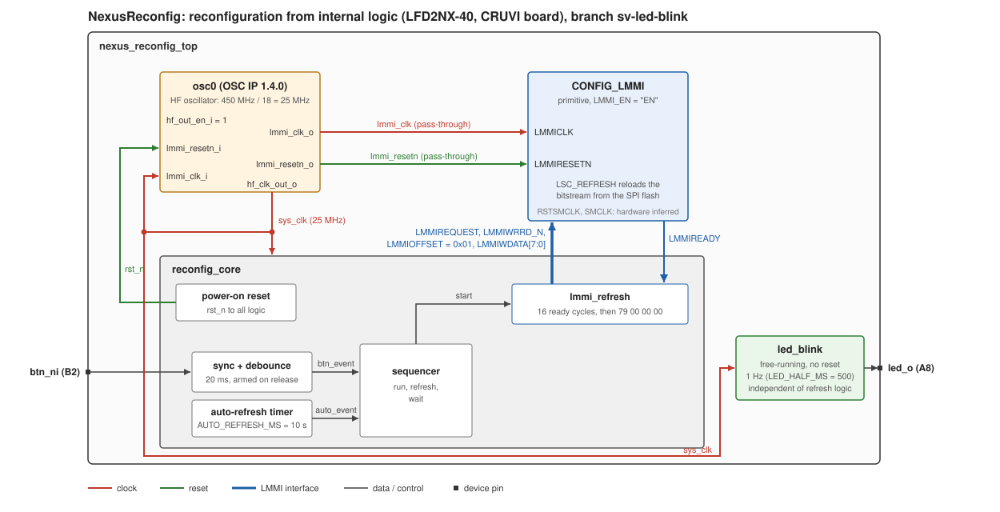

# NexusReconfig - Certus-NX reconfiguration from internal logic (branch `sv-led-blink`)

| Info: | Details |
| :-- | :-- |
| Device | Certus-NX LFD2NX-40-8BG196C |
| Board | CRUVI Certus-NX board |
| Software | Radiant 2026.1.1 (Synplify Pro), Questa (bundled with Radiant) |
| HDL | Two equivalent implementations: SystemVerilog ([`src/sv/`](src/sv/)) and VHDL-2008 ([`src/vhdl/`](src/vhdl/)); SystemVerilog testbenches; OSC IP Verilog |
| IP | osc 1.4.0 ([`lscc/osc0/`](lscc/osc0/)) |

## Notes

- This reference design shows how user logic inside a Certus-NX FPGA can force the device to
  reconfigure itself, with no external pin (PROGRAMN), JTAG cable or host involved.
- The design writes the `LSC_REFRESH` command (opcode `0x79`) to the device's configuration block
  through the `CONFIG_LMMI` primitive. `LSC_REFRESH` is equivalent to toggling PROGRAMN: the
  configuration SRAM is cleared and the bitstream is reloaded from the boot source, which on
  Certus-NX is the external SPI flash.
- The reconfiguration therefore loads **whatever image is in the SPI flash**.
- **This branch (`sv-led-blink`)** is a reduced variant of `main`:
  - No UART and no status LEDs: the reconfiguration logic (`reconfig_core`) has no outputs to
    device pins.
  - A separate module, `led_blink` ([`sv`](src/sv/led_blink.sv), [`vhdl`](src/vhdl/led_blink.vhd)),
    flashes one LED (A8) at 1 Hz. It is not connected to the reconfiguration logic: it has no
    reset and no input other than the clock.
  - Both languages, as on `main`: one Radiant project builds the implementation `impl_sv`
    (project default) or `impl_vhdl`. The two are checked against each other cycle by cycle in
    simulation and both were tested on the board.
- Because no pin depends on the reconfiguration logic, the `CONFIG_LMMI` instance carries two
  attributes, `syn_noprune` (synthesis) and `NOCLIP` (map). Without them the tools remove the
  primitive and the whole refresh path as unused logic. The exact forms that work, and those
  that do not, were determined by experiment (see "Keeping the refresh logic: `NOCLIP`").

## Releases (git tags)

Releases are annotated, signed tags named `r<Radiant version>` (later releases on the same
version add `-<n>`); the tag message holds the details. All tags are on `main`; this branch is
not tagged.

| Tag | Tool version | IP versions | Content | Verification |
| :-- | :-- | :-- | :-- | :-- |
| `r2026.1.1` (on `main`) | Radiant 2026.1.1 | osc 1.4.0 | First release: SystemVerilog (`impl_sv`) and VHDL-2008 (`impl_vhdl`) implementations in one project, testbenches in both languages | Both implementations: timing met, RTL simulation PASS, lock-step equivalence 0 mismatches, hardware test passed on the CRUVI board |

To rebuild a release, check out its tag in a separate worktree (`git worktree add ../<folder>
r<ver>`) and build with that release's Radiant version.

## How it works



1. After configuration a power-on counter releases the reconfiguration logic.
2. A reconfiguration request comes from either:
   - a press on the active-low input `btn_ni` (pin B2), debounced for 20 ms. The input must be
     seen released before a press counts, so a stuck-low input cannot cause a refresh loop; or
   - the auto-refresh timer, 10 s after the reset release (`AUTO_REFRESH_MS`, 0 disables it).
3. `lmmi_refresh` waits for 16 consecutive cycles with `LMMIREADY` high, then writes the four
   bytes `79 00 00 00` (opcode and three operands) to LMMI offset `0x01`.
4. The device reconfigures from the SPI flash. If the flash holds this design, the sequence
   starts again at step 1.

Independently of these steps, `led_blink` toggles `led_o` (A8) every 500 ms from the moment the
device enters user mode. Its counter and LED register start from their configuration value (0);
it shares only `sys_clk` with the rest of the design. A refresh reconfigures the whole device, so
the LED is dark for the reconfiguration time (about 1.8 s measured, see "Hardware results") and
starts again from off. That gap is the visible sign of a refresh.

### Keeping the refresh logic: `NOCLIP`

**Why it is needed.** In `main`, `LMMIREADY` steers the sequencer, which drives the UART and the
LEDs, so the path from the oscillator through `reconfig_core` and `CONFIG_LMMI` ends at device
pins. Without those outputs the path is a loop (`reconfig_core` to `CONFIG_LMMI`, `LMMIREADY`
back to `reconfig_core`) with no valid end. Two separate tools remove it:

1. **Synthesis (Synplify Pro)** removes a primitive whose outputs drive nothing. `syn_noprune`
   on the instance prevents this (it was already present on `main`). Without it, `CONFIG_LMMI`
   is missing from the synthesis netlist (`.vm`).
2. **Map** ("Removing unused logic", when the netlist is converted to the UDB database) removes
   every path without a valid input and a valid output. Valid outputs are an output pad or a
   net with `NOCLIP` (Radiant Constraints Reference Guide, "NOCLIP"). Map removes the loop
   without a warning, and the map report's "Removed logic" section does not list it; the only
   sign is `Config LMMI: 0 out of 1` and a low register count (37 instead of 89). The first build
   of this branch had exactly this, loaded on the board, and never refreshed. RTL simulation and
   elaboration cannot show it.

**Form used in this design** (both languages): both attributes on the `CONFIG_LMMI` instance.

```systemverilog
// src/sv/nexus_reconfig_top.sv
CONFIG_LMMI #(.LMMI_EN ("EN")) config_lmmi_inst ( ... ) /* synthesis syn_noprune=1 NOCLIP=1 */;
```

```vhdl
-- src/vhdl/nexus_reconfig_top.vhd (architecture declarative part)
attribute syn_noprune : boolean;
attribute NOCLIP      : boolean;
attribute syn_noprune of config_lmmi_inst : label is true;
attribute NOCLIP      of config_lmmi_inst : label is true;
```

Synplify writes `NOCLIP` into the netlist as `(* NOCLIP=1 *) CONFIG_LMMI config_lmmi_inst (...)`
(VHDL `true` becomes `1`), and map reads it from there. Check after every build:
`Config LMMI: 1 out of 1` in `lscc/impl_<L>/nexus_reconfig_impl_<L>.mrp`.

**Experiment** (2026-11-16, Radiant 2026.1.1, synthesis and map of this design, one variant per
project; "kept" means `Config LMMI: 1 out of 1` and 89 registers, "removed" means
`0 out of 1` and 37 registers, or 25 when synthesis already removed it):

| Where | Form | Synplify, SV | Synplify, VHDL | LSE, SV |
| :-- | :-- | :-- | :-- | :-- |
| None | `syn_noprune` on the instance only | removed | removed | removed |
| HDL, instance | `syn_noprune` + `NOCLIP` | **kept** | **kept** | **kept** |
| HDL, instance | `NOCLIP` without `syn_noprune` | removed by synthesis (25 registers) | removed by synthesis (25 registers) | not tested |
| HDL, nets | `syn_keep` + `NOCLIP` on all five LMMI nets | **kept** | **kept** | not tested |
| HDL, one net | `syn_keep` + `NOCLIP` on `lmmi_ready` only (or `lmmi_request` only, SV) | **kept** | **kept** | **kept** |
| HDL, nets | `NOCLIP` without `syn_keep` | removed: Synplify does not pass the attribute to the netlist | removed | not tested |
| HDL, one net | `syn_keep` without `NOCLIP` | removed | not tested | not tested |
| Synplify `.fdc` | `define_attribute {i:config_lmmi_inst} {NOCLIP} {1}` (`syn_noprune` in HDL) | **kept** | not tested | n/a |
| Synplify `.fdc` | `define_attribute {i:config_lmmi_inst} {syn_noprune} {1}` and `{NOCLIP} {1}`, no HDL attributes | **kept** | **kept** | n/a |
| Synplify `.fdc` | `define_attribute {n:lmmi_ready} {syn_keep} {1}` and `{NOCLIP} {1}` | **kept** | not tested | n/a |
| Pre-synthesis `.sdc` / LSE `.ldc` | `ldc_set_attribute {NOCLIP=1} [get_cells ...]` or `[get_nets ...]` | removed | not tested | removed |
| Post-synthesis `.pdc` | `ldc_set_attribute {NOCLIP}`, `{NOCLIP=1}`, `{NOCLIP=TRUE}` on the net or the cell | removed | removed | not tested |

Notes on the constraint-file forms:

- `ldc_set_attribute` does **not** accept `NOCLIP` in Radiant 2026.1.1, although the "NOCLIP" help
  page shows `ldc_set_attribute {NOCLIP} [get_nets net_a]` as its `.ldc` example. In the `.sdc`
  and LSE `.ldc` the tool reports `WARNING <1225032> - The attribute key 'NOCLIP' in constraint
  'ldc_set_attribute' is not supported` and lists the valid keys (`FORMAT, CODE, TEMPERATURE,
  GSR, GSR_NET, USE_PRIMARY, ...`); the bare form `{NOCLIP}` is read as an empty attribute (`{}`).
- In the `.pdc`, the objects no longer exist: the `.pdc` is applied after map's removal step, so
  map reports `Can't resolve object 'lmmi_ready'` and drops the constraint.
- The working constraint-file route is the Synplify `.fdc` (`define_attribute`). It produces the
  same `(* NOCLIP=1 *)` in the netlist as the HDL attribute.

### LMMI protocol

From the sysCONFIG User Guide for Nexus Platform, FPGA-TN-02099-3.7, Appendix D:

- The configuration register has the fixed LMMI offset `ADDR_CFG = 0x01` (D.3).
- A command is an opcode byte and three operand bytes, written back to back with
  `LMMIREQUEST` and `LMMIWRRD_N` high; a byte is taken on each clock edge where `LMMIREADY` is
  high (Figures D.4 to D.6).
- `LSC_REFRESH` is the only Class D command and is executed as a Class C command (no data, no
  read-back). Once it executes, the LMMI host in the fabric no longer exists (D.3).
- `OPERAND1 = 0x00` leaves the Override ENABLE bit (bit 6) clear, so the refresh uses the
  device's normal boot settings (Table 6.20).
- Wait at least four LMMI clock cycles after `LMMIREADY` is high before issuing a command (D.3).
- `LMMICLK` is at most 50 MHz (Table D.1). `LMMICLK` and `LMMIRESETN` must come from the OSC IP's
  `lmmi_clk_o` / `lmmi_resetn_o` pass-through outputs, or the software stops with an error (D.2).
  The OSC IP is generated with `LMMI_CLK_EN = ENABLED`.
- `RSTSMCLK` and `SMCLK` are hardware inferred and left unconnected, as in FPGA-RD-02294.

The command sequence is the `LSC_REFRESH` step of the refresh controller in the Lattice Nexus
Multi-Boot reference design FPGA-RD-02294 (`source/impl_1/refresh.v`), without its Multi-Boot steps
(`ISC_ENABLE_X`, `LSC_PROG_CNTRL0`, `ISC_DISABLE` and the `MULTIBOOT` primitive), which are only
needed to select an alternate image.

## Contents

| Path | Content |
| :-- | :-- |
| [`src/sv/nexus_reconfig_top.sv`](src/sv/nexus_reconfig_top.sv), [`src/vhdl/nexus_reconfig_top.vhd`](src/vhdl/nexus_reconfig_top.vhd) | Top level: OSC IP, `CONFIG_LMMI` primitive (with `syn_noprune` and `NOCLIP`), `reconfig_core`, `led_blink` |
| [`src/sv/reconfig_core.sv`](src/sv/reconfig_core.sv), [`src/vhdl/reconfig_core.vhd`](src/vhdl/reconfig_core.vhd) | Power-on reset, button debounce, auto timer, sequencer |
| [`src/sv/lmmi_refresh.sv`](src/sv/lmmi_refresh.sv), [`src/vhdl/lmmi_refresh.vhd`](src/vhdl/lmmi_refresh.vhd) | LMMI host that writes `LSC_REFRESH` |
| [`src/sv/led_blink.sv`](src/sv/led_blink.sv), [`src/vhdl/led_blink.vhd`](src/vhdl/led_blink.vhd) | Free-running LED flasher, independent of the refresh logic |
| [`src/vhdl/nexus_reconfig_pkg.vhd`](src/vhdl/nexus_reconfig_pkg.vhd) | VHDL only: `clog2` |
| [`lscc/osc0/`](lscc/osc0/) | Generated OSC IP (25 MHz HF clock, LMMI clock path enabled), used by both implementations |
| [`lscc/nexus_reconfig.rdf`](lscc/nexus_reconfig.rdf) | Radiant project with the implementations `impl_sv` (default) and `impl_vhdl` |
| [`lscc/nexus_reconfig_*_{sv,vhdl}_ftusb0.xcf`](lscc/) | Programmer chain files per implementation (see "Running on the board") |
| [`constraints/nexus_reconfig.pdc`](constraints/nexus_reconfig.pdc) | Clock, pins, INITN release, false paths (post-synthesis) |
| [`constraints/nexus_reconfig.sdc`](constraints/nexus_reconfig.sdc) | Clock for synthesis |
| [`tb/tb_reconfig_core.sv`](tb/tb_reconfig_core.sv) | Self-checking testbench with an LMMI target model, for `reconfig_core` and `led_blink` (ports only: runs against either implementation) |
| [`tb/tb_equiv.sv`](tb/tb_equiv.sv) | Lock-step equivalence testbench: VHDL-2008 against SystemVerilog |
| [`sim/sim_sv_filelist.f`](sim/sim_sv_filelist.f) | SystemVerilog design, testbench |
| [`sim/sim_vhdl_svtb_filelist.f`](sim/sim_vhdl_svtb_filelist.f) | VHDL design, same testbench |
| [`sim/equiv_filelist.f`](sim/equiv_filelist.f) | `tb_equiv` with both implementations |
| [`sim/lint_top_sv_filelist.f`](sim/lint_top_sv_filelist.f), [`sim/lint_top_vhdl_filelist.f`](sim/lint_top_vhdl_filelist.f) | Elaborate-only check of the full top level, per implementation |
| [`sim/run_vhdl.do`](sim/run_vhdl.do) | Questa run script for the simulations with VHDL design units |
| [`scripts/create_project.tcl`](scripts/create_project.tcl) | Re-creates the Radiant project with both implementations (VHDL-2008 enabled) |
| [`scripts/build_all.tcl`](scripts/build_all.tcl) | Builds both implementations |
| [`scripts/make_sv_ref.sh`](scripts/make_sv_ref.sh) | Copies the SystemVerilog modules with `ref_` names into `sim/mcp_sim/sv_ref/` for `tb_equiv` |
| [`logs/`](logs/) | Programmer logs and raw UART captures of the hardware tests |
| [`docs/`](docs/) | FPGA-TN-02099 ([`sysCONFIG`](docs/FPGA-TN-02099-sysCONFIG-User-Guide-Nexus.pdf)) and FPGA-TN-02145 ([`Multi-Boot`](docs/FPGA-TN-02145-Multi-Boot-User-Guide-Nexus.pdf)) user guides, block diagram ([`block_diagram.svg`](docs/block_diagram.svg)) |

### Ports and pins

| Port | Pin | Direction | Function |
| :-- | :-- | :-- | :-- |
| `btn_ni` | B2 | in, pull-up | Reconfiguration request, active low |
| `led_o` | A8 | out | 1 Hz flash from `led_blink`, independent of the refresh logic |

Pins come from the CRUVI board design
(`/mnt/lscc/devel/Boards/CertusNX/cruvi/CruviDemo/test_certus/test_certus.pdc`). B2 is the INITN
sysCONFIG pin; like the CRUVI design, the [`.pdc`](constraints/nexus_reconfig.pdc) releases it with
`ldc_set_sysconfig {INITN_PORT=DISABLE}`. The second LED (B8) and the UART pin (F11) are not
used on this branch.

### Parameters (`nexus_reconfig_top`)

| Parameter | Default | Meaning |
| :-- | :-- | :-- |
| `AUTO_REFRESH_MS` | 10000 | Auto-refresh delay after the reset release; 0 = button only |
| `LED_HALF_MS` | 500 | LED on time and off time (500 = 1 Hz) |
| `LED_ACTIVE_LOW` | `1'b0` / `false` | Set if the board LED lights on a low level (SystemVerilog `bit`, VHDL `boolean`) |

## Reproducing the results

All Lattice tools run on the build host `lb` with Radiant 2026.1.1, through the `lattice-prompt`
MCP server.

1. **Oscillator IP** (already in [`lscc/osc0/`](lscc/osc0/); only needed to regenerate it):
   `radiant_ip_generate(name=osc0, ip_module_dir=/mnt/tools/lscc/radiant/2026.1.1/ip/lifcl/osc,
   device=LFD2NX-40, family=LFD2NX, package=CABGA196, performance=8_High-Performance_1.0V,
   operation=Commercial, output_dir=<project>/lscc/osc0,
   cfg_values="HF_OSC_EN:ENABLED; HF_CLK_FREQ:25; LF_OUTPUT_EN:DISABLED; SEDCLK_EN:0; LMMI_CLK_EN:ENABLED")`.
2. **Project** (already in [`lscc/nexus_reconfig.rdf`](lscc/nexus_reconfig.rdf); only needed to re-create it):
   `radiant_build_detached(tcl_path=<project>/scripts/create_project.tcl)`
   ([`scripts/create_project.tcl`](scripts/create_project.tcl)). The tool reports `failed`
   because no build stage runs; check that [`lscc/nexus_reconfig.rdf`](lscc/nexus_reconfig.rdf)
   lists `impl_sv` and `impl_vhdl`.
3. **Build both implementations:** `radiant_build_detached(tcl_path=<project>/scripts/build_all.tcl)`
   ([`scripts/build_all.tcl`](scripts/build_all.tcl)), `radiant_build_wait(project_dir=<project>/scripts)`,
   then `validate_timing(project_path=<project>/lscc/impl_sv)` and
   `validate_timing(project_path=<project>/lscc/impl_vhdl)`. Check `Config LMMI: 1 out of 1` in
   both map reports (`lscc/impl_<L>/nexus_reconfig_impl_<L>.mrp`, see "Keeping the refresh
   logic"). Do not use `radiant_build_detached(rdf_path=..., impl=impl_vhdl)`: the MCP tool
   ignores `impl` and always builds the default implementation (`impl_sv`).
4. **RTL simulation, both implementations:** `simulate_rtl_detached(work_dir=<project>/sim/mcp_sim/<run>,
   sim_dir=<project>/sim/mcp_sim/<run>/system_sim, device=LFD2NX-40-8BG196C,
   sim_filelist=<project>/sim/<list>, top=tb_reconfig_core, skip_validate=true, clean=true)`,
   then `simulate_rtl_wait`, with [`sim_sv_filelist.f`](sim/sim_sv_filelist.f) / `sv_blink` and
   [`sim_vhdl_svtb_filelist.f`](sim/sim_vhdl_svtb_filelist.f) / `vhdl_svtb_blink`. Pass
   criterion: `TEST PASSED` in `sim.log`.
5. **Equivalence of the two implementations:** run [`scripts/make_sv_ref.sh`](scripts/make_sv_ref.sh)
   (WSL or `lb`), then as step 4 with `sim_filelist=<project>/sim/equiv_filelist.f`
   ([`sim/equiv_filelist.f`](sim/equiv_filelist.f)), `top=tb_equiv`, `<run>=equiv_blink` and
   `libdirs=[/mnt/tools/lscc/radiant/2026.1.1/cae_library/simulation/verilog/uaplatform]`.
   Pass criterion: `TEST PASSED: VHDL-2008 and SystemVerilog implementations match cycle for cycle`.
6. **Full top-level elaboration** (with the OSCA, CONFIG_CLKRST_CORE and CONFIG_LMMI library
   cells): as step 4 with [`lint_top_sv_filelist.f`](sim/lint_top_sv_filelist.f) (`<run>=lint_blink`)
   and [`lint_top_vhdl_filelist.f`](sim/lint_top_vhdl_filelist.f) (`<run>=lint_vhdl_blink`),
   `top=nexus_reconfig_top`, `elaborate_only=true` and
   `libdirs=[/mnt/tools/lscc/radiant/2026.1.1/cae_library/simulation/verilog/lfd2nx,
   /mnt/tools/lscc/radiant/2026.1.1/cae_library/simulation/verilog/uaplatform]`.

The file lists with VHDL design units compile with `-vcom.options -2008 -end` and run
[`sim/run_vhdl.do`](sim/run_vhdl.do), which suppresses numeric_std metavalue warnings for the
time-0 delta cycles only (registers without a reset value are `'U'` until the power-on reset
clears them).

## Verification results (2026-11-16, Radiant 2026.1.1)

| Check | SystemVerilog (`impl_sv`) | VHDL-2008 (`impl_vhdl`) |
| :-- | :-- | :-- |
| RTL simulation ([`tb_reconfig_core`](tb/tb_reconfig_core.sv)) | `TEST PASSED`, 9 checks, 0 errors, 0 warnings | `TEST PASSED`, 9 checks, 0 errors, 0 warnings |
| Elaborate-only, full top level with device library cells | 0 errors, 2 warnings (`vopt-2958 Implicit wire '<protected>'`, inside the encrypted Lattice library cells) | Same |
| Timing (`validate_timing`) | Met at all corners, 0 failing endpoints, constraint coverage 100 % | Same |
| Worst setup slack, `sys_clk` 25 MHz (85 °C) | +35.785 ns | +35.274 ns |
| Worst hold slack | +0.199 ns | +0.199 ns |
| Resources | 137 LUT4, 89 registers, 1 OSC, 1 CONFIG_LMMI, 2 I/O | Same |
| Hardware, CRUVI board, `LSC_REFRESH` | **Passed** (UART capture, see "Hardware results") | **Passed** |
| Hardware, LED flash on A8 | **Observed** (earlier SystemVerilog build with net-level `NOCLIP`, same `led_blink`) | Not observed separately |

| Check across both implementations | Result |
| :-- | :-- |
| Lock-step equivalence ([`tb_equiv`](tb/tb_equiv.sv)) | `TEST PASSED`: 4 `reconfig_core` parameter sets and 2 `led_blink` instances (active high and low), about 60 000 cycles each, 0 mismatches, 0 warnings |

### Testbench

[`tb/tb_reconfig_core.sv`](tb/tb_reconfig_core.sv) runs on a scaled clock (1 MHz):

- **A**, auto-refresh timer (5 ms), button released: exactly `79 00 00 00` to offset `0x01`, at
  least four `LMMIREADY` cycles before the command, random `LMMIREADY` back-pressure, and no
  LMMI request before the timer has expired.
- **B**, timer disabled, button pressed once: the same command, not before the press plus the
  debounce time.
- **C**, timer disabled, button stuck low: no LMMI transfer.
- **L**, `led_blink` with a 2 ms half period, active high and active low: off at time 0 with no
  reset, 20 edges in 40 ms at exactly 2 ms spacing, and the active-low output always the
  complement.

[`tb/tb_equiv.sv`](tb/tb_equiv.sv) runs the SystemVerilog modules (renamed `ref_*` by
[`scripts/make_sv_ref.sh`](scripts/make_sv_ref.sh), because both implementations share one
library) and the VHDL entities side by side with identical stimulus, and compares every output
on every clock: `reconfig_core` from the release of the power-on reset (`rst_no` from time 0),
`led_blink` from time 0. The `reconfig_core` scenarios are the auto-refresh timer with random
`LMMIREADY` back-pressure, a bouncing button with a short glitch, a button stuck low, and button
noise with a 4-cycle LMMI gap and long `LMMIREADY` stretches. The test also fails if the stimulus
did not produce the refresh (four LMMI bytes) in the three refreshing scenarios, or the LED
edges.

What they do not cover:

- `CONFIG_LMMI` itself. Lattice supplies no supported simulation model (FPGA-TN-02099 Table D.1,
  note 1), so the testbench uses a behavioural model of the documented write protocol. Whether
  the silicon executes the refresh can only be shown on hardware.
- The thin top level (`nexus_reconfig_top`, OSC IP wiring) and map's removal of unused logic
  (see "Keeping the refresh logic"). They are checked by elaboration, the map report and the
  board, not by simulation.

### Known build warnings (reviewed, harmless)

- `The clock sys_clk has been defined multiple times` / `Cannot have multiple create_clock ...`:
  synthesis exports the [`.sdc`](constraints/nexus_reconfig.sdc) clock into the implementation constraints; the identical [`.pdc`](constraints/nexus_reconfig.pdc)
  definition is the one that is used (timing report section 1.1).
- `nexus_reconfig.sdc (2): Can't resolve object .../gen_osca.u_OSC_A/HFCLKOUT`: the RTL pin name is
  valid in synthesis (the Synplify report shows `sys_clk` declared at 25 MHz), but not in the
  post-synthesis netlist, where the [`.pdc`](constraints/nexus_reconfig.pdc) uses `.../gen_osca.u_OSC_A.OSCA_inst/HFCLKOUT`.
- `Clock osc0_inst_hf_clk_out_o is overridden ... by clock sys_clk`: the OSC IP's own constraint is
  replaced by the project's `sys_clk`.
- A clock `osc0_inst/lscc_osc_inst/sed_sec_out_w` (225 MHz on `HFSDCOUT`) appears in the timing
  report. It is derived from the OSC IP and has no paths.
- `User-specified initial value defined for some sequential elements` (FX474): the power-on reset
  counter, `rst_n` and the `led_blink` counter and LED register start from their
  configuration-time value of 0, as intended.
- `Input rstsmclk/smclk of instance config_lmmi_inst is floating` (CL167) and
  `Input RSTSMCLK/SMCLK ... undriven`: hardware-inferred pins of `CONFIG_LMMI`, left unconnected
  as in FPGA-RD-02294 and in the FPGA-TN-02099 example.
- `Unbound component CONFIG_LMMI of instance config_lmmi_inst` (Synplify Z198, `impl_vhdl` only):
  the VHDL top level declares the primitive as a component; Synplify maps it to the
  `CONFIG_LMMI` library cell, as the netlist and the map report (Config LMMI 1/1) show.
- `Blackbox OSCA / CONFIG_CLKRST_CORE / CONFIG_LMMI is missing a user supplied timing model`
  (synthesis only); place and route and timing analysis use the device models.
- `Signal u_core/u_lmmi_refresh/..._reg[n].intGnd undriven or does not drive anything - clipped`
  (map, INFO): constant-0 helper nets of the registers; the registers themselves are kept (map
  report: 89 registers, Config LMMI 1/1).

## Running on the board

`LSC_REFRESH` reloads the configuration from the SPI flash, so the result depends on what the
flash holds. The JTAG cable and the UART are the board's FT2232H (USB serial `FT7BCWYB`): channel
A is JTAG (`FTUSB-0` when only this board is attached; the index changes with the attached
boards), channel B is the UART.

Chain files ([`lscc/`](lscc/), all for `USB2` / `FTUSB-0`, device `LFD2NX-40`, IDCODE `0x310F1043`),
one set per implementation (`<L>` = `sv` or `vhdl`, using `lscc/impl_<L>/nexus_reconfig_impl_<L>.bit`):

| File | Operation |
| :-- | :-- |
| `nexus_reconfig_verifyid_<L>_ftusb0.xcf`: [`sv`](lscc/nexus_reconfig_verifyid_sv_ftusb0.xcf), [`vhdl`](lscc/nexus_reconfig_verifyid_vhdl_ftusb0.xcf) | Verify ID (read-only board identification) |
| `nexus_reconfig_sram_<L>_ftusb0.xcf`: [`sv`](lscc/nexus_reconfig_sram_sv_ftusb0.xcf), [`vhdl`](lscc/nexus_reconfig_sram_vhdl_ftusb0.xcf) | Fast Configuration (SRAM, lost at power-off) |
| `nexus_reconfig_spiflash_<L>_ftusb0.xcf`: [`sv`](lscc/nexus_reconfig_spiflash_sv_ftusb0.xcf), [`vhdl`](lscc/nexus_reconfig_spiflash_vhdl_ftusb0.xcf) | External SPI flash: Erase, Program, Verify through the FPGA loader (JTAG2SPI) |
| `nexus_reconfig_refresh_<L>_ftusb0.xcf`: [`sv`](lscc/nexus_reconfig_refresh_sv_ftusb0.xcf), [`vhdl`](lscc/nexus_reconfig_refresh_vhdl_ftusb0.xcf) | JTAG Refresh: reload the configuration from the SPI flash |

The bitstream sizes in the SPI flash chain files (`DataSize`) are those of the `main` builds; update it
before writing this branch's bitstream to the flash.

This design has no UART, so a refresh is shown in one of two ways:

- **With the `main` build in the flash:** load this design into SRAM while capturing the UART.
  The line stays silent while this design runs; about 10 s later its `LSC_REFRESH` boots the
  `main` build from the flash, which prints `NexusReconfig: FPGA configured`.
- **With this design in the flash:** the LED on A8 flashes at 1 Hz and goes dark for about 1.8 s
  every 10 s, while the device reconfigures.

The UART capture runs on `lb`:
`python3 /mnt/lscc/devel/Claude/Cruvi/scripts/uart_capture.py --serial FT7BCWYB --interface B --baud 115200 --seconds 45`.
Start the capture before the load, and load with `pgrcmd -infile <chain file>`
(`/mnt/tools/lscc/radiant/2026.1.1/programmer/bin/lin64`): a capture started at the same time as
the programmer fails with `unable to claim usb device`. To time the events, prefix each output
line with `date +%T.%3N` (as in the results below).

### Hardware results

All on 2026-11-16, with the SPI flash holding the `main` SystemVerilog build and this branch
loaded into SRAM. In each capture the line is silent while this branch's design runs; the banner
of the `main` build about 10 s after the load shows that this design's `LSC_REFRESH`
reconfigured the device from the flash.

Final builds (instance attributes `syn_noprune` + `NOCLIP`, as in the sources):

| Implementation | Load finished (`pgrcmd`, `Operation: successful.`) | Banner of the `main` build | Capture |
| :-- | :-- | :-- | :-- |
| SystemVerilog | 12:37:01.6 | 12:37:11.98 | [`logs/uart_blink_sv_sram_load_20261116.bin`](logs/uart_blink_sv_sram_load_20261116.bin) |
| VHDL-2008 | 12:37:34.7 | 12:37:45.02 | [`logs/uart_blink_vhdl_sram_load_20261116.bin`](logs/uart_blink_vhdl_sram_load_20261116.bin) |

First working SystemVerilog build (`syn_keep` + `NOCLIP` on the five LMMI nets and `NOCLIP` on
the instance; same mapped resources)
([`logs/uart_blink_sram_load_20261116.bin`](logs/uart_blink_sram_load_20261116.bin), 104 bytes):

| Time | Event |
| :-- | :-- |
| 12:05:30.9 | SRAM load starts (`pgrcmd`, `Operation: successful.`) |
| 12:05:42.8 | Programmer exits; this design runs, the UART is silent |
| 12:05:53.1 | Banner of the `main` build: this design's `LSC_REFRESH` reconfigured the device from the flash |
| 12:06:02.8 | `main` build: `issuing LSC_REFRESH` |
| 12:06:04.6 | `main` build: banner again (reconfiguration time about 1.8 s) |

The LED flash on A8 and its interruption by the refresh were checked by eye on this build
(confirmed by the user).

The very first build of this branch (no `NOCLIP`) loaded successfully but produced 0 bytes on the
UART in 45 s: it never issued the refresh, because map had removed `CONFIG_LMMI`.

## Open items

- This branch's bitstreams have not been written to the SPI flash.
- The LED flash has not been observed with the final builds (instance-level attributes) or with
  the VHDL build; their refresh was confirmed by UART capture only.
- LED polarity on the CRUVI board is not confirmed (`LED_ACTIVE_LOW`, default 0).
- Whether B2 is connected to a push button on the CRUVI board is not confirmed (the CRUVI demo
  names it `rstn_i`). The auto-refresh timer works without it.
- The I/O standard is left at the tool default, as in the CRUVI board design; the bank voltages
  were not checked against the board schematic.

## References

- sysCONFIG User Guide for Nexus Platform, FPGA-TN-02099-3.7, October 2026
  ([`docs/FPGA-TN-02099-sysCONFIG-User-Guide-Nexus.pdf`](docs/FPGA-TN-02099-sysCONFIG-User-Guide-Nexus.pdf)): Appendix D (CONFIG_LMMI), Table 6.18,
  Table 6.20, Table D.3.
- Multi-Boot User Guide for Nexus Platform, FPGA-TN-02145
  ([`docs/FPGA-TN-02145-Multi-Boot-User-Guide-Nexus.pdf`](docs/FPGA-TN-02145-Multi-Boot-User-Guide-Nexus.pdf)).
- Lattice Nexus Device Multi-Boot Reference Design, FPGA-RD-02294
  (`/mnt/lscc/reference/designs/FPGA-RD-02294-Lattice-Nexus-Device-Multi-Boot-RD-Source-RevA-241006`).
- Radiant 2026.1.1 help, Constraints Reference Guide, NOCLIP.
- Radiant 2026.1.1 help, FPGA Libraries Reference Guide, CONFIG_LMMI (architectures supported:
  LFD2NX).
